# Báo cáo chứng minh cơ chế React, TypeScript, Vite và TanStack trong Mekong Journeys

Ngày đối chiếu: 23/10/2026. Phạm vi: source local sau khi hợp nhất TanStack Router, UI kiểm thử Error Boundary/Suspense và khôi phục React Hook Form từ commit `ff25c1e` trên remote main.

Báo cáo theo tám tiêu chí của [REPORT-REACT-VITE-TANSTACK.md](REPORT-REACT-VITE-TANSTACK.md). Mỗi tiêu chí đi theo chuỗi **khái niệm/cơ chế → thực hành hoặc mã nguồn → kết quả → ý nghĩa và vị trí trong source**. Các đoạn code được rút gọn để làm rõ cơ chế; tên hàm và cấu hình đều lấy từ source.


Ảnh mã nguồn bên dưới được dựng trực tiếp từ file local, giữ nguyên nội dung và số dòng; không phải ảnh chụp trình soạn thảo hay kết quả chạy. Khoảng bỏ qua giữa các trích đoạn được đánh dấu rõ. Tên file, khoảng dòng và SHA-256 nằm trong ảnh và [manifest ảnh](evidence/source-code/manifest.json). Có thể tạo lại bằng `scripts/render-report-code.py` (cần Python và Pillow). Ảnh phản ánh source tại lúc tạo.

## Quy ước về bằng chứng

- **Đối chiếu source:** kết luận rút từ mã đang có, chưa đồng nghĩa đã chạy thành công trên trình duyệt.
- **Minh chứng lịch sử:** JSON đã lưu trong `docs/evidence`, chủ yếu ghi ngày 21/10/2026, trước lần merge và khôi phục form hiện tại. Những số liệu này chỉ chứng minh lần thực nghiệm được ghi trong file đó.
- **Lần chạy gần nhất trong phiên làm việc:** `npm test` có 31 test đạt, một test file `tests/router.test.ts` thất bại do thiếu package TanStack Router trong `node_modules`. Không coi đây là một suite đạt toàn bộ. Cài dependencies chưa hoàn tất; chưa có kết quả build, lint, typecheck và browser đầy đủ cho source sau khôi phục form.

Ứng dụng sử dụng mock adapter trả Promise, chưa có backend HTTP hay thanh toán thật. Quy tắc giá và idempotency là nghiệp vụ của đồ án; việc sử dụng chúng tự thân không chứng minh React, Vite hoặc TanStack.

## 1. Component, props, state và vòng đời React

### Khái niệm/cơ chế

React dựng cây component từ JSX. Props truyền dữ liệu và callback xuống cây; state cập nhật qua setter khiến React tính lại UI. `useEffect` chạy phần đồng bộ sau commit và trả cleanup để giải phóng tài nguyên khi dependency thay đổi hoặc component unmount. Đây là vòng đời gắn với React, khác với việc chỉ chia HTML thành nhiều file.

### Thực hành hoặc mã nguồn

- [`CheckoutPage.tsx`](../src/features/booking/pages/CheckoutPage.tsx) ghép `ContactForm` và `BookingSummary`, truyền contact, lỗi và callback qua props.
- [`BookingContactProvider.tsx`](../src/features/booking/components/BookingContactProvider.tsx) giữ `contact` và `agree` bằng `useState`, cung cấp qua `ContactContext`.
- [`use-checkout.ts`](../src/features/booking/hooks/use-checkout.ts) cập nhật contact bất biến:

```tsx
setContact(previous => ({ ...previous, [field]: value }));
```

- [`TourGallery.tsx`](../src/components/TourGallery.tsx) render `Lightbox` có điều kiện khi `index !== null`. Trong Lightbox:

```tsx
useEffect(() => {
  const d = dialog.current;
  d?.showModal();
  return () => d?.close();
}, []);
```

`showModal()` là API trình duyệt; phần riêng của React ở đây là `useRef` giữ DOM node và effect/cleanup gắn thao tác đó với mount/unmount. [`SectionNav.tsx`](../src/components/SectionNav.tsx) tương tự: tạo observer trong effect, gọi `disconnect()` khi cleanup.

Form hiện dùng **React Hook Form**, không còn là ví dụ thuần controlled input như báo cáo cũ. [`ContactForm.tsx`](../src/features/booking/components/ContactForm.tsx) có:

```tsx
const { register, formState: { errors: formErrors } } =
  useForm<ContactFormData>({
    resolver: zodResolver(contactSchema),
    mode: "onBlur",
    reValidateMode: "onChange",
    defaultValues: { ...contact, agree: false },
  });
```

`register(name, { onChange, onBlur })` gắn ref và handler của React Hook Form lên input, đồng thời chuyển sự kiện về contact context. [`contactSchema.ts`](../src/schemas/contactSchema.ts) dùng Zod kiểm tra dữ liệu runtime, bao gồm trim tên, chuẩn hóa điện thoại và email tùy chọn.


<!-- SOURCE-IMAGES-1 -->
### Ảnh trích source chính xác

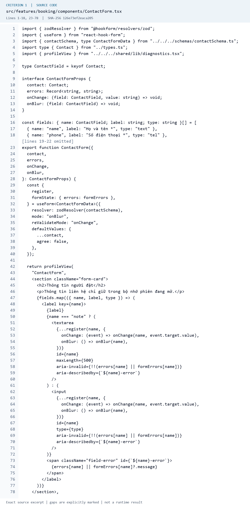

*React Hook Form: useForm, resolver, register và lỗi field. Nguồn: `src/features/booking/components/ContactForm.tsx`, dòng 1–18, 23–78.*

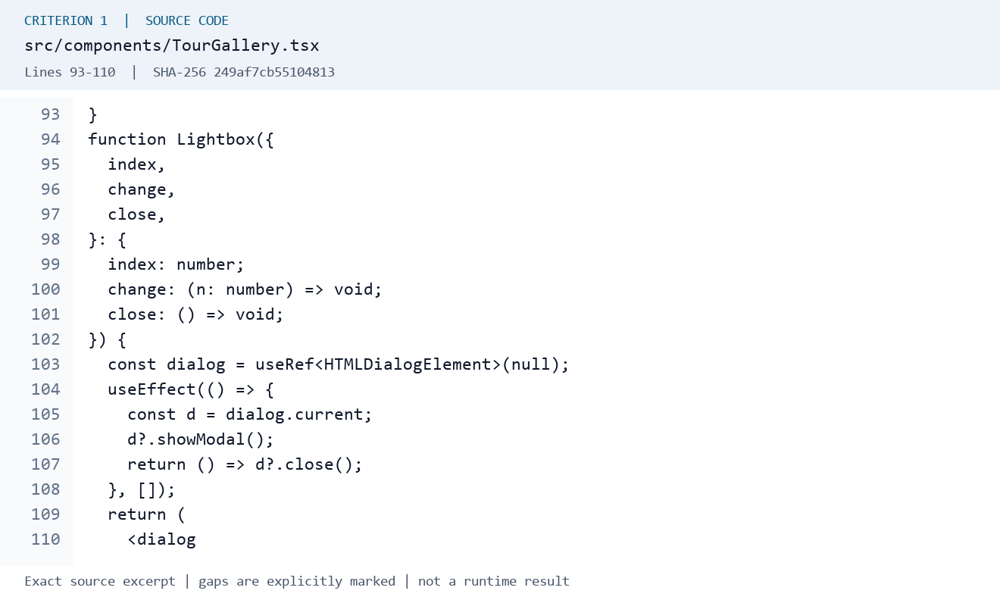

*Effect mở dialog và cleanup khi Lightbox unmount. Nguồn: `src/components/TourGallery.tsx`, dòng 93–110.*

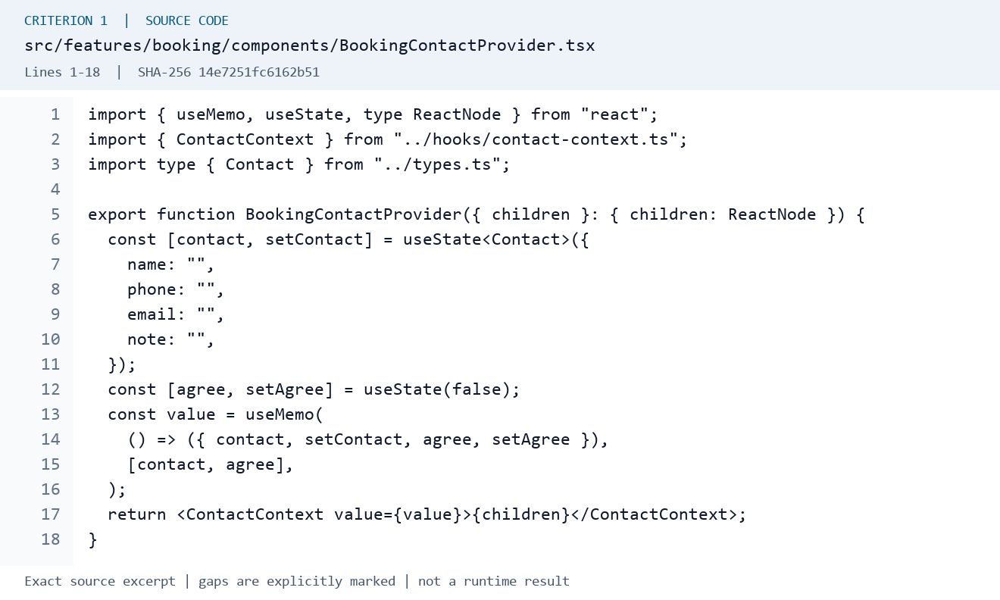

*State và context chia sẻ contact trong cây React. Nguồn: `src/features/booking/components/BookingContactProvider.tsx`, dòng 1–18.*

<!-- /SOURCE-IMAGES-1 -->

### Kết quả

Source thể hiện contact có thể được chia sẻ qua provider, trong khi state ảnh chỉ nằm ở gallery. Đóng Lightbox làm component unmount và cleanup đóng dialog. Lỗi field có thể đến từ `formState.errors` của React Hook Form và từ `errors` do checkout truyền vào.

Form/schema đã được đối chiếu hash và khớp nội dung remote main ở lần khôi phục. Đây là bằng chứng khôi phục source; chưa phải kiểm thử browser của form mới khôi phục.

### Ý nghĩa và vị trí của cơ chế

React sở hữu cây UI và vòng đời; React Hook Form sở hữu đăng ký field và trạng thái validation của form con; Zod mô tả luật kiểm tra runtime. Điểm cần trình bày chính xác: submit hiện vẫn là `onSubmit={checkout.submit}` ở trang checkout; hook đó gọi `contactErrors`, chưa dùng `handleSubmit` của React Hook Form. Vì thế không được viết rằng React Hook Form đang điều phối toàn bộ submit hoặc là nguồn validation duy nhất. `agree` được kiểm tra khi submit ở hook checkout, không phải một field đã đăng ký trong `ContactForm`.

**Tự kiểm:** dấu hiệu công nghệ là JSX/component tree, setter state, Context, effect cleanup, `useForm`, `register` và `zodResolver`; một dự án chỉ dùng DOM thuần không có những hợp đồng này.

## 2. Routing và giao tiếp dữ liệu

### Khái niệm/cơ chế

TanStack Router biểu diễn route bằng cây route, có params, search validation, loader và context. TanStack Query quản lý dữ liệu mà loader/component cùng dùng. Điểm chứng minh không nằm ở việc “website có nhiều trang”, mà ở cách route được đăng ký, dữ liệu route được chuẩn hóa và nối vào cache.

### Thực hành hoặc mã nguồn

[`App.tsx`](../src/app/App.tsx) render `RouterProvider`. [`routes.tsx`](../src/app/routes.tsx) định nghĩa root layout với `Outlet`, các route con và context chứa cùng `queryClient` mà app provider sử dụng:

```tsx
export const toursRoute = createRoute({
  getParentRoute: () => rootRoute,
  path: "/tours",
  validateSearch: search => parseTourSearch(search),
  loaderDeps: ({ search }) => search,
  loader: ({ context, deps }) =>
    context.queryClient.ensureQueryData(tourQueryOptions(deps)),
  component: /* component trang danh sách */,
});
```

Route chi tiết dùng `path: "/tours/$slug"`, đọc `tourDetailRoute.useParams()`, rồi loader dùng `params.slug`. [`use-tour-search.ts`](../src/features/tours/hooks/use-tour-search.ts) lấy search đã chuẩn hóa bằng `toursRoute.useSearch()`, chuyển trang bằng `useNavigate`. [`search.ts`](../src/features/tours/domain/search.ts) xử lý kiểu string/object và loại các số không hợp lệ.

Luồng hiện tại:

```text
URL → route match → validateSearch → loaderDeps
    → loader/ensureQueryData → QueryClient → mock service
    → Outlet/trang → useQuery cùng key → trạng thái UI
```


<!-- SOURCE-IMAGES-2 -->
### Ảnh trích source chính xác

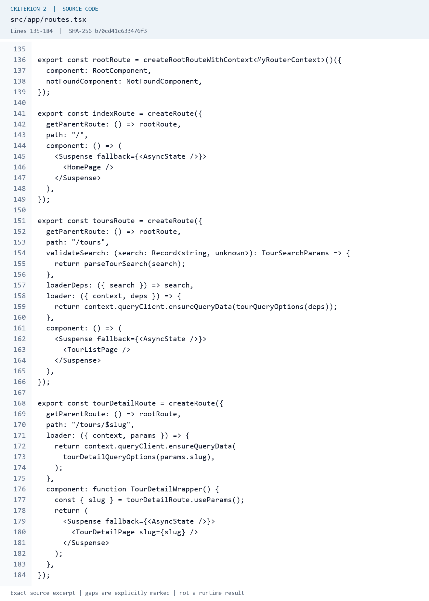

*Route tree, validateSearch, loader và params có kiểu. Nguồn: `src/app/routes.tsx`, dòng 135–184.*

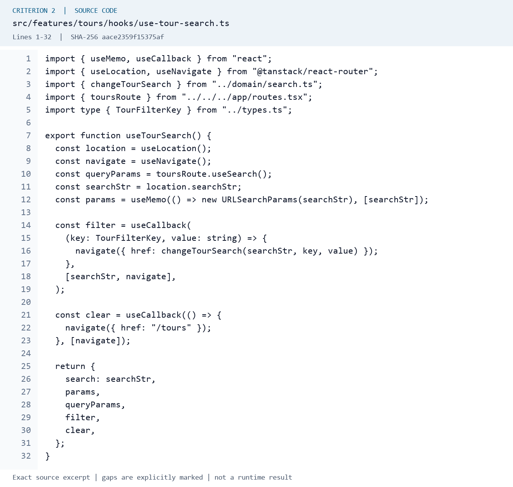

*Đọc search từ route và cập nhật URL bằng useNavigate. Nguồn: `src/features/tours/hooks/use-tour-search.ts`, dòng 1–32.*

<!-- /SOURCE-IMAGES-2 -->

### Kết quả

Đối chiếu source cho thấy loader và query hook dùng chung `tourQueryOptions`, vì vậy cùng định danh cache thay vì tự định nghĩa hai request độc lập. `tests/tanstack-router.test.ts` hiện kiểm tra parser search typed, không còn kiểm thử route tree/loader như tên commit ban đầu có thể gợi ý. Kiểm thử browser sau merge chưa được xác nhận.

### Ý nghĩa và vị trí của cơ chế

`routes.tsx` là nơi khai báo route và chuẩn bị dữ liệu; `use-tour-search.ts` đưa route state vào UI; service chỉ chứa thao tác dữ liệu. `defaultPreload: "intent"` đã được cấu hình nhưng nhiều liên kết dùng `AppLink` dựa trên thẻ `a` và `navigateTo`; không đủ bằng chứng nói mọi link đã preload khi hover. Cũng không khẳng định `ensureQueryData` xóa toàn bộ waterfall tải mã và dữ liệu.

**Tự kiểm:** `createRoute`, `$slug`, `validateSearch`, `loaderDeps`, `Outlet` và `ensureQueryData` là các cơ chế cụ thể đã nối với nhau trong source. SPA hay query params nói chung không đủ chứng minh TanStack Router.

## 3. TypeScript và môi trường phát triển Vite

### Khái niệm/cơ chế

TypeScript kiểm tra hợp đồng kiểu trước khi chạy; Vite phục vụ module trong development và tích hợp plugin React để hỗ trợ vòng sửa code/Fast Refresh. Kiểm tra kiểu và kiểm tra runtime là hai cơ chế khác nhau.

### Thực hành hoặc mã nguồn

[`types.ts`](../src/features/booking/types.ts) định nghĩa `Draft`, `Contact`, `Booking` cùng union trạng thái. `TourFilterKey` ở [`types.ts`](../src/features/tours/types.ts) giới hạn tên filter. `tsconfig.app.json` bật `strict`, `noUnusedLocals`, `noUnusedParameters`, `jsx: "react-jsx"` và `moduleResolution: "bundler"`.

Trong `routes.tsx`, module augmentation đăng ký kiểu router:

```ts
declare module "@tanstack/react-router" {
  interface Register { router: typeof router }
}
```

`vite.config.ts` dùng `plugins: [react()]`. `package.json` phân biệt `dev: vite`, `build: tsc -b && vite build` và lệnh `typecheck`. Việc gọi `tsc` rõ ràng trong script là phần tạo kiểm tra kiểu, không phải Vite tự typecheck khi transform TypeScript.


<!-- SOURCE-IMAGES-3 -->
### Ảnh trích source chính xác

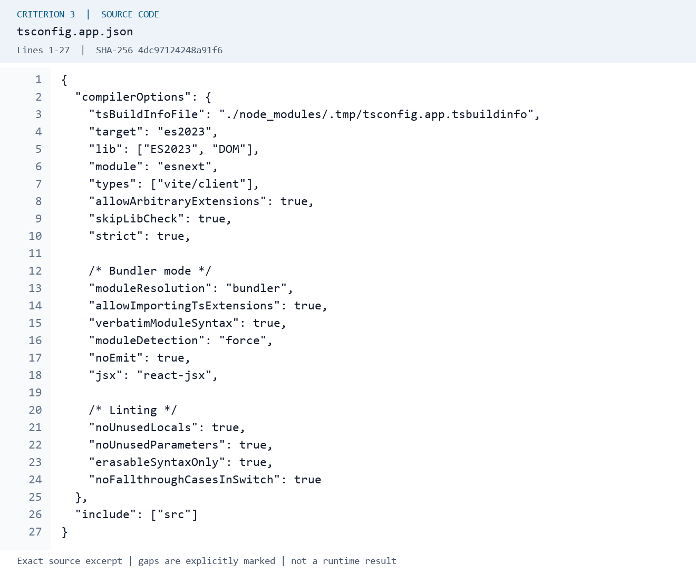

*Cấu hình strict, JSX và module resolution của TypeScript. Nguồn: `tsconfig.app.json`, dòng 1–27.*

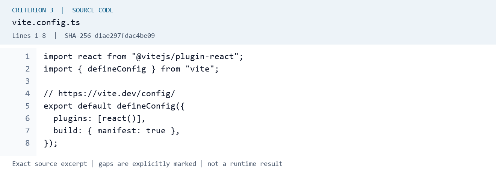

*Plugin React và manifest của Vite build. Nguồn: `vite.config.ts`, dòng 1–8.*

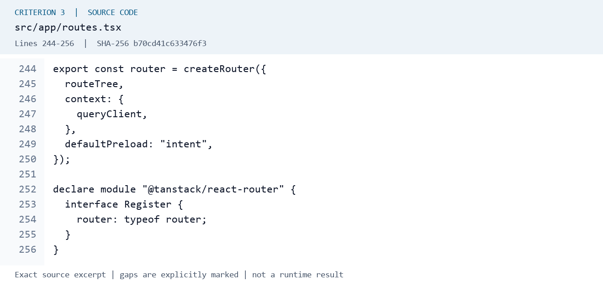

*Đăng ký kiểu router qua TypeScript module augmentation. Nguồn: `src/app/routes.tsx`, dòng 244–256.*

<!-- /SOURCE-IMAGES-3 -->

### Kết quả

Source cung cấp hợp đồng kiểu cho props, draft và query search. Tuy nhiên nhiều điểm điều hướng còn dùng `navigate({ href: url })` với chuỗi động; chưa thể nói mọi đường dẫn được kiểm tra kiểu hoàn toàn.

Minh chứng lịch sử [`hmr-check.json`](evidence/hmr-check.json) ghi `observedHeadingUpdate: true`, `retainedContactState: true`, `restoredSource: true`: thay tiêu đề component đã cập nhật giao diện mà giữ state trong thử nghiệm đó. Sau merge và khôi phục React Hook Form chưa đo HMR lại. Build/typecheck hiện tại chưa được xác nhận do dependencies chưa cài đủ.

### Ý nghĩa và vị trí của cơ chế

Kiểu nằm ở entity/props/route; cấu hình TypeScript quy định lỗi nào compiler phải bắt; plugin React của Vite phục vụ phát triển. Zod ở schema vẫn cần thiết vì TypeScript không xác nhận JSON/storage ở runtime. Không suy ra “form hợp lệ” chỉ từ kiểu `Contact`.

**Tự kiểm:** union type, generic `Partial<Draft>`, module augmentation của router, cấu hình compiler và thí nghiệm Fast Refresh là dấu vết cụ thể; “code chia module, dễ bảo trì” không đủ chứng minh TypeScript/Vite.

## 4. Render, re-render, key, memo và callback

### Khái niệm/cơ chế

React dùng vị trí, kiểu component và `key` để giữ hoặc thay identity khi đối chiếu cây UI. `memo` có thể bỏ render từ cha nếu props không đổi; `useCallback` ổn định tham chiếu hàm theo dependency. Những cơ chế này khác với việc chỉ nhận xét ứng dụng “chạy nhanh”.

### Thực hành hoặc mã nguồn

[`BookingSummary.tsx`](../src/features/booking/components/BookingSummary.tsx) xuất `memo(BookingSummaryView)`. `useCheckout` tạo callback ổn định cho sửa draft, áp voucher và chấp nhận giá; summary không nhận object contact. `CheckoutPage` có nhánh DEV `?profile=baseline` chọn cùng view nhưng bỏ wrapper memo để đối chứng.

[`diagnostics.tsx`](../src/shared/lib/diagnostics.tsx) bọc view trong React `Profiler`, lưu `phase`, `actualDuration`, `baseDuration`, `commitTime` khi DEV. `TourListPage` dùng `key={tour.id}` cho card; `TourDetailPage` dùng `key={query.data.id}` cho `TourDetailContent` để reset state cục bộ khi đổi tour.


<!-- SOURCE-IMAGES-4 -->
### Ảnh trích source chính xác

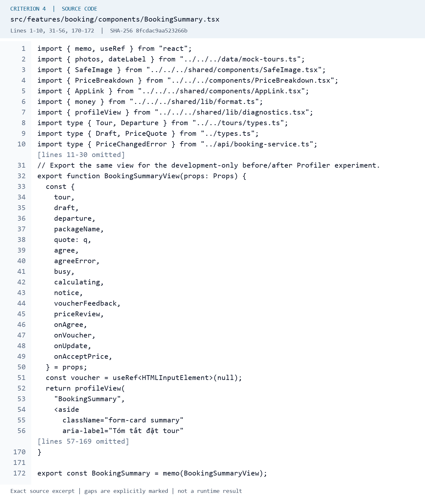

*BookingSummaryView, Profiler wrapper và React.memo. Nguồn: `src/features/booking/components/BookingSummary.tsx`, dòng 1–10, 31–56, 170–172.*

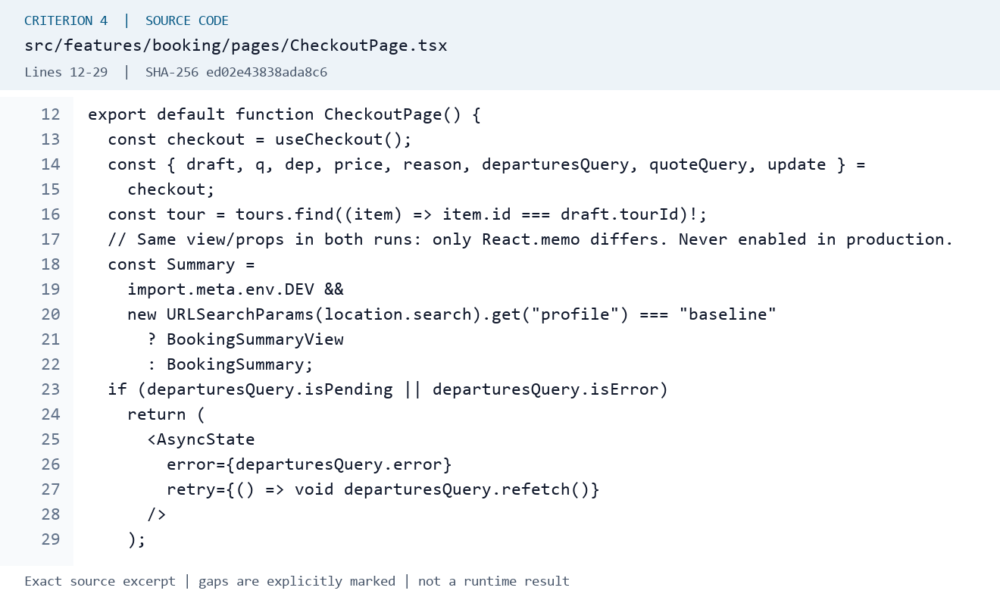

*Cùng view: chọn baseline hoặc memo trong development. Nguồn: `src/features/booking/pages/CheckoutPage.tsx`, dòng 12–29.*

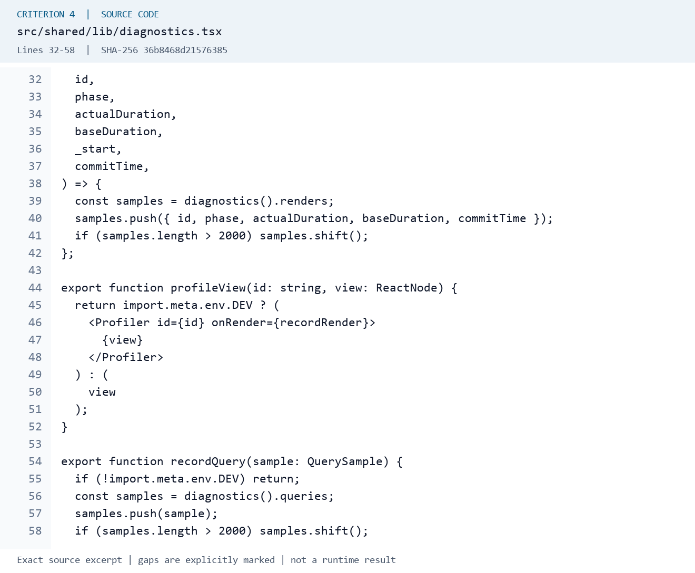

*React Profiler ghi commit và actualDuration. Nguồn: `src/shared/lib/diagnostics.tsx`, dòng 32–58.*

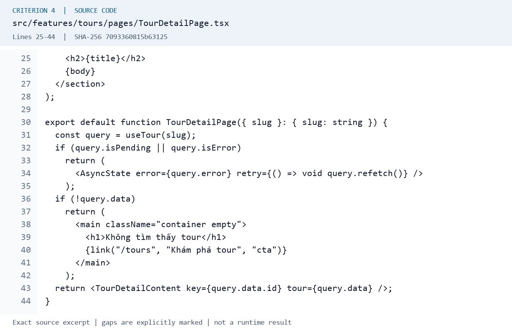

*Key theo ID tour xác định identity của component nội dung. Nguồn: `src/features/tours/pages/TourDetailPage.tsx`, dòng 25–44.*

<!-- /SOURCE-IMAGES-4 -->

### Kết quả

[`render-profile.json`](evidence/render-profile.json) ghi phép đo cũ cùng 18 ký tự nhập: `BookingSummary` có 18 commit cập nhật ở baseline và 0 ở bản memo; `ContactForm` vẫn có 18 commit ở cả hai. Số này chứng minh summary bỏ render trong kịch bản đã đo, không chứng minh toàn ứng dụng nhanh hơn theo cùng tỷ lệ. Form hiện đã khôi phục RHF nên phải đo lại trước khi gắn số này cho source hiện tại.

### Ý nghĩa và vị trí của cơ chế

Wrapper memo đặt tại component summary vì nơi đó có props có thể giữ ổn định khi contact đổi. Callback ổn định chỉ hỗ trợ so sánh props, không tự ngăn component cha render. State/context mà summary tự đọc vẫn có thể làm nó cập nhật. `key` quản lý identity, không phải cơ chế chặn render.

**Tự kiểm:** bằng chứng nằm ở `memo`, dependency của callback, key theo ID và sample React Profiler; không thay chúng bằng nhận xét chung “tối ưu hiệu năng”.

## 5. Rules of Hooks và custom hooks

### Khái niệm/cơ chế

React liên kết state của hook với thứ tự gọi hook. Vì vậy các hook thông thường phải được gọi ổn định ở cấp đầu component/custom hook. Dependency của effect/callback quyết định khi nào logic được tạo lại và dữ liệu nào nằm trong closure.

### Thực hành hoặc mã nguồn

[`use-booking-selection.ts`](../src/features/booking/hooks/use-booking-selection.ts) kết hợp draft với departure/quote; [`use-checkout.ts`](../src/features/booking/hooks/use-checkout.ts) kết hợp lựa chọn, contact context, mutation và lỗi nghiệp vụ. `CheckoutPage` gọi `useCheckout()` trước conditional return cho trạng thái dữ liệu.

`onContactChange` dùng functional update nên không cần đóng trên một bản contact cũ. `onContactBlur` phụ thuộc `[contact, agree]` để validation đọc dữ liệu hiện tại. `acceptPrice` dùng `[priceReview, refetchQuote]`, refetch báo giá của lựa chọn hiện hành thay vì chép báo giá cũ vào key mới.

`useRef` giữ `inFlight` để chặn hai event submit sát nhau mà không chờ render mới. [`providers.tsx`](../src/app/providers.tsx) subscribe QueryCache trong effect và trả unsubscribe. `eslint.config.js` bật `reactHooks.configs.flat.recommended`.


<!-- SOURCE-IMAGES-5 -->
### Ảnh trích source chính xác

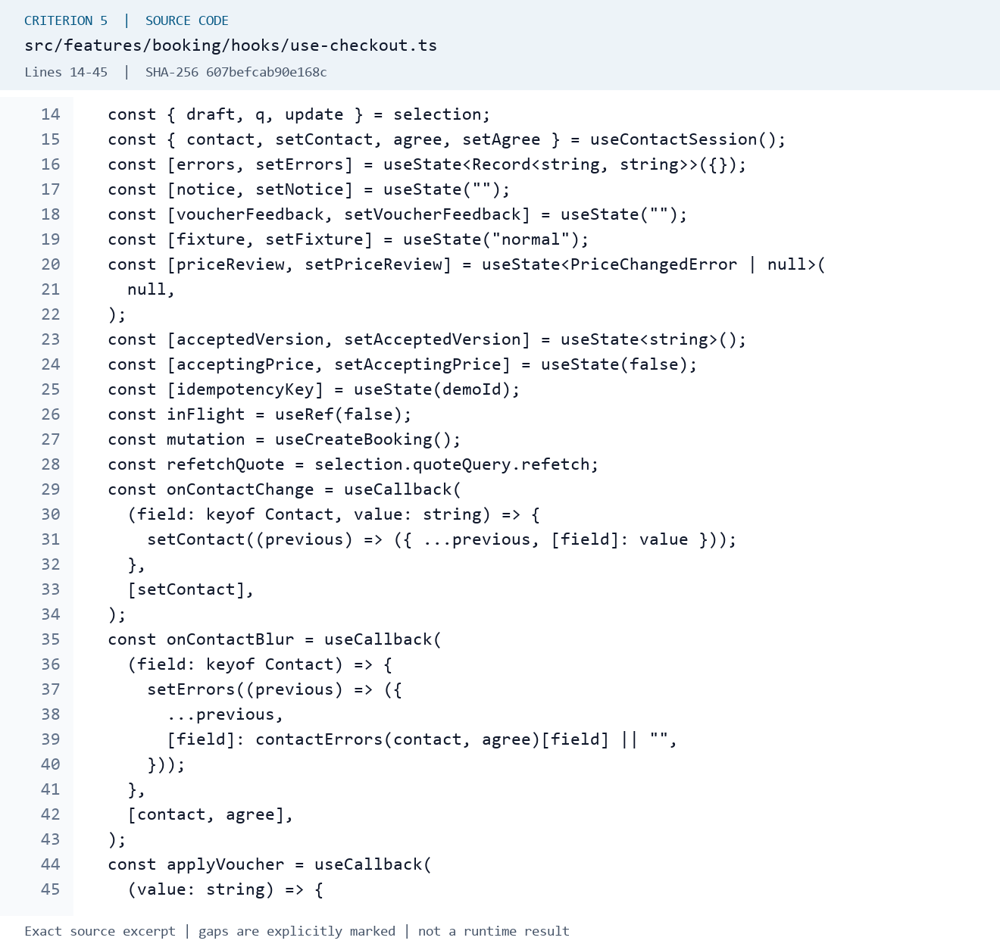

*useRef, useCallback, functional update và dependency của closure. Nguồn: `src/features/booking/hooks/use-checkout.ts`, dòng 14–45.*

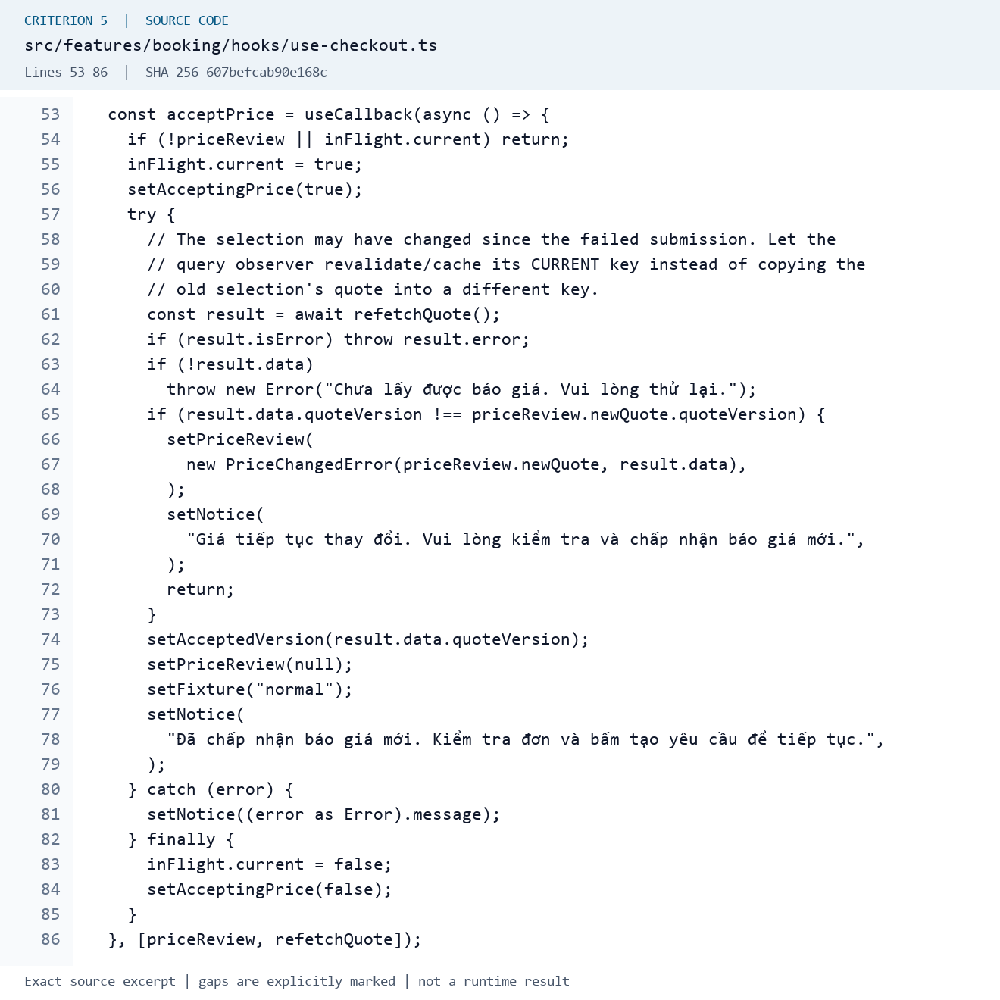

*Custom hook refetch quote hiện tại và xử lý version giá. Nguồn: `src/features/booking/hooks/use-checkout.ts`, dòng 53–86.*

<!-- /SOURCE-IMAGES-5 -->

### Kết quả

Source tách quy trình khỏi JSX trang và cho phép tái sử dụng logic. Kiểm thử nghiệp vụ về idempotency/price review có trong `tests/booking.test.ts`; phiên gần nhất các test đó đạt. Chưa có lần lint thành công cho source hiện tại, nên cấu hình ESLint là bằng chứng đã thiết lập kiểm tra, không phải kết quả lint đạt.

### Ý nghĩa và vị trí của cơ chế

Custom hook là lớp kết nối React state/context/query với nghiệp vụ. Hai component gọi cùng một custom hook không mặc nhiên dùng chung state; ở đây state chung đến từ cùng provider hoặc cùng QueryClient/key. `inFlight` ref là bảo vệ UI, còn idempotency của adapter là quy tắc khác, không phải tính năng riêng React.

**Tự kiểm:** thứ tự hook, closure/dependency, functional update, ref tồn tại qua render và unsubscribe theo effect là phần cần giải thích; tên hàm bắt đầu bằng `use` tự thân chưa đủ.

## 6. Phân chia client state và server state

### Khái niệm/cơ chế

React Context phân phối lựa chọn/UI state trong cây component. TanStack Query quản lý dữ liệu bất đồng bộ theo query identity, observer, freshness và invalidation. Phân loại này được thể hiện bằng hai hệ thống lưu trữ/vòng đời cụ thể.

### Thực hành hoặc mã nguồn

| Dữ liệu | Cơ chế và vị trí source | Vòng đời |
|---|---|---|
| Draft ngày/gói/khách/voucher/tỷ lệ trả | `BookingDraftProvider`, `DraftContext` | State React; effect persist `mj-draft` có version/savedAt |
| Contact, đồng ý chính sách | `BookingContactProvider`, `ContactContext` | Memory trong provider; không persist cùng draft |
| Field registration, lỗi resolver | `useForm` trong `ContactForm` | Vòng đời form con |
| Search/sort/page | `toursRoute.useSearch()` | Gắn URL và navigation |
| Tour/departure/quote/result | Query hooks và `QueryClientProvider` | Cache theo key, freshness/observer/invalidation |

`AppProviders` đặt QueryClient và hai provider ở ngoài `App`/route outlet. `BookingDraftProvider` dùng `useMemo` cho context value; `transitionDraft` xử lý thay đổi draft; tổng tiền suy ra bằng domain quote, không sao chép thành nhiều state tổng tiền.


<!-- SOURCE-IMAGES-6 -->
### Ảnh trích source chính xác

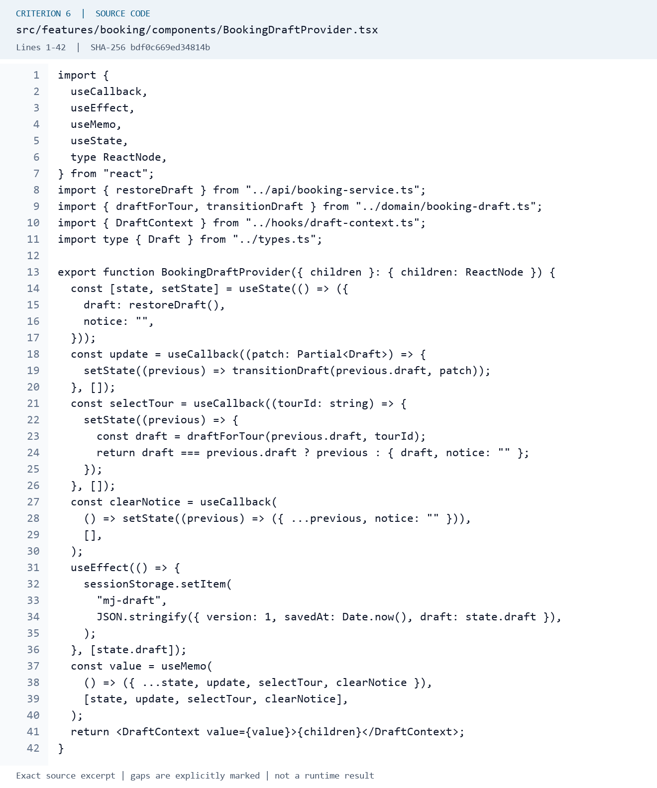

*Client state draft, cập nhật bất biến, persist và memo context value. Nguồn: `src/features/booking/components/BookingDraftProvider.tsx`, dòng 1–42.*

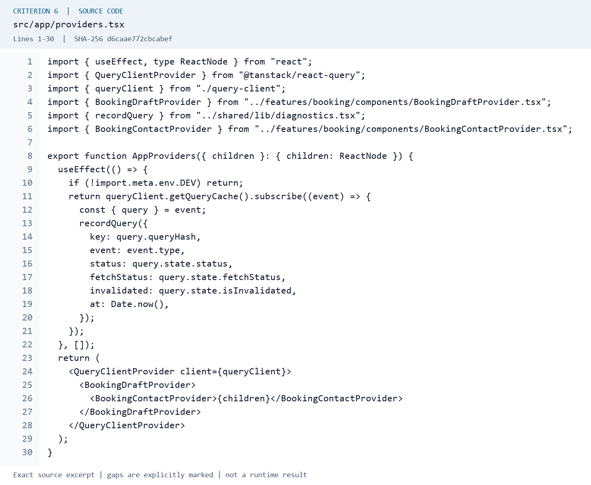

*QueryClientProvider cùng hai React provider và cleanup subscription. Nguồn: `src/app/providers.tsx`, dòng 1–30.*

<!-- /SOURCE-IMAGES-6 -->

### Kết quả

Đối chiếu source cho thấy thay route không đồng nghĩa unmount provider contact/draft, nên có cơ sở giữ dữ liệu khi sửa lựa chọn. Draft không có trường contact. Những điều này không đồng nghĩa contact được lưu bền sau reload: provider memory được tạo lại khi tải lại ứng dụng.

### Ý nghĩa và vị trí của cơ chế

Context trả lời “người dùng đang chọn gì”; QueryClient trả lời “dữ liệu adapter trả về cho lựa chọn ấy hiện là gì”. Draft có departure ID không bảo đảm departure còn mở bán; submit vẫn phải kiểm tra lại. Adapter là giả lập nên báo cáo gọi đây là server state mô phỏng, không suy diễn đã có backend.

**Tự kiểm:** provider placement, `useContext`, QueryClient cache và key chứng minh cách đồ án dùng React/TanStack để sở hữu state; bảng phân loại client/server đơn thuần thì công nghệ nào cũng có thể viết.

## 7. TanStack Query: key, freshness, observer và invalidation

### Khái niệm/cơ chế

Query key xác định một bản dữ liệu trong cache. `staleTime` quyết định thời gian dữ liệu được coi fresh; `gcTime` quản lý cache không còn được quan sát. Mutation có vòng đời riêng và có thể invalidates query liên quan. Đây là cơ chế của QueryClient, không phải lời gọi Promise thông thường.

### Thực hành hoặc mã nguồn

[`tour-keys.ts`](../src/features/tours/api/tour-keys.ts) chuẩn hóa chuỗi tìm kiếm và chứa filter/page trong list key. [`booking-keys.ts`](../src/features/booking/api/booking-keys.ts) đưa departure/package, từng nhóm khách, voucher chuẩn hóa và tỷ lệ trả vào quote key.

[`query-client.ts`](../src/app/query-client.ts) cấu hình mặc định `staleTime: 60_000`, `gcTime: 300_000`, `retry: 1`, `refetchOnWindowFocus: false`; mutation không retry. Query chi tiết có staleTime 5 phút, departure 30 giây, quote 15 giây, result 0. `useTours` dùng `placeholderData: keepPreviousData`; quote chỉ enabled khi đủ departure/package.

[`booking-mutations.ts`](../src/features/booking/api/booking-mutations.ts) gọi sau khi tạo đơn thành công:

```ts
await client.invalidateQueries({
  queryKey: bookingKeys.quote(input.draft),
  exact: true,
});
```


<!-- SOURCE-IMAGES-7 -->
### Ảnh trích source chính xác

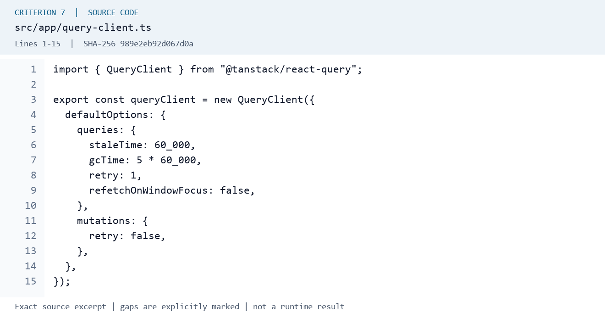

*Chính sách freshness, GC, retry và focus của QueryClient. Nguồn: `src/app/query-client.ts`, dòng 1–15.*

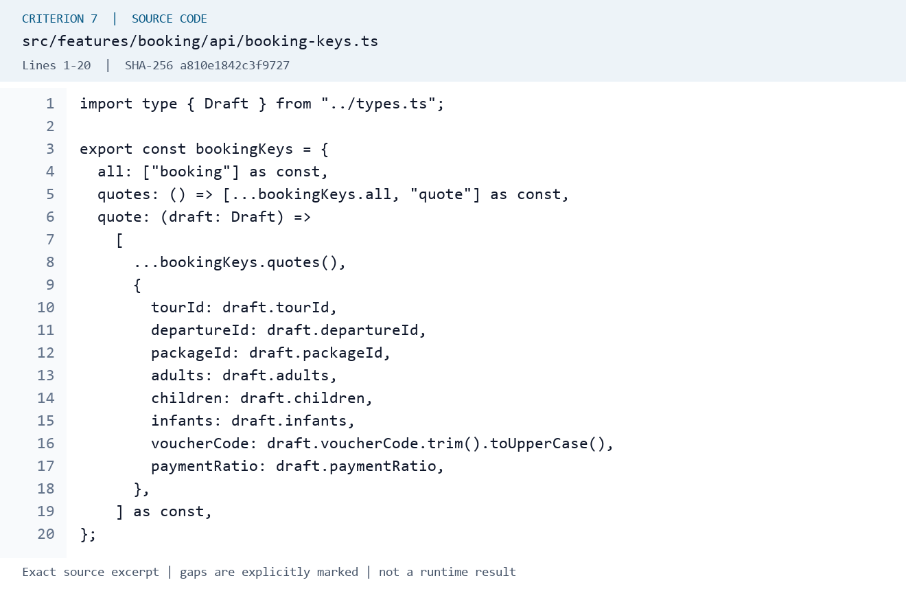

*Định danh quote cache chứa các lựa chọn ảnh hưởng báo giá. Nguồn: `src/features/booking/api/booking-keys.ts`, dòng 1–20.*

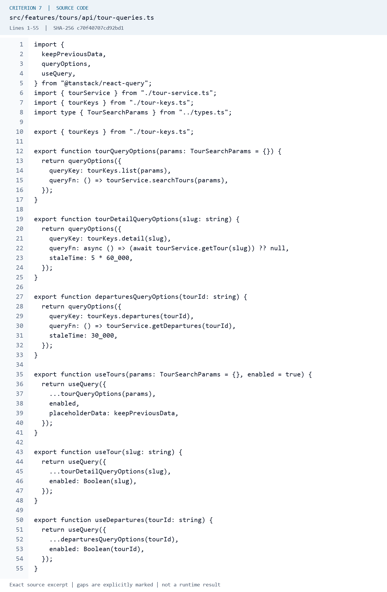

*queryOptions, useQuery, enabled và keepPreviousData. Nguồn: `src/features/tours/api/tour-queries.ts`, dòng 1–55.*

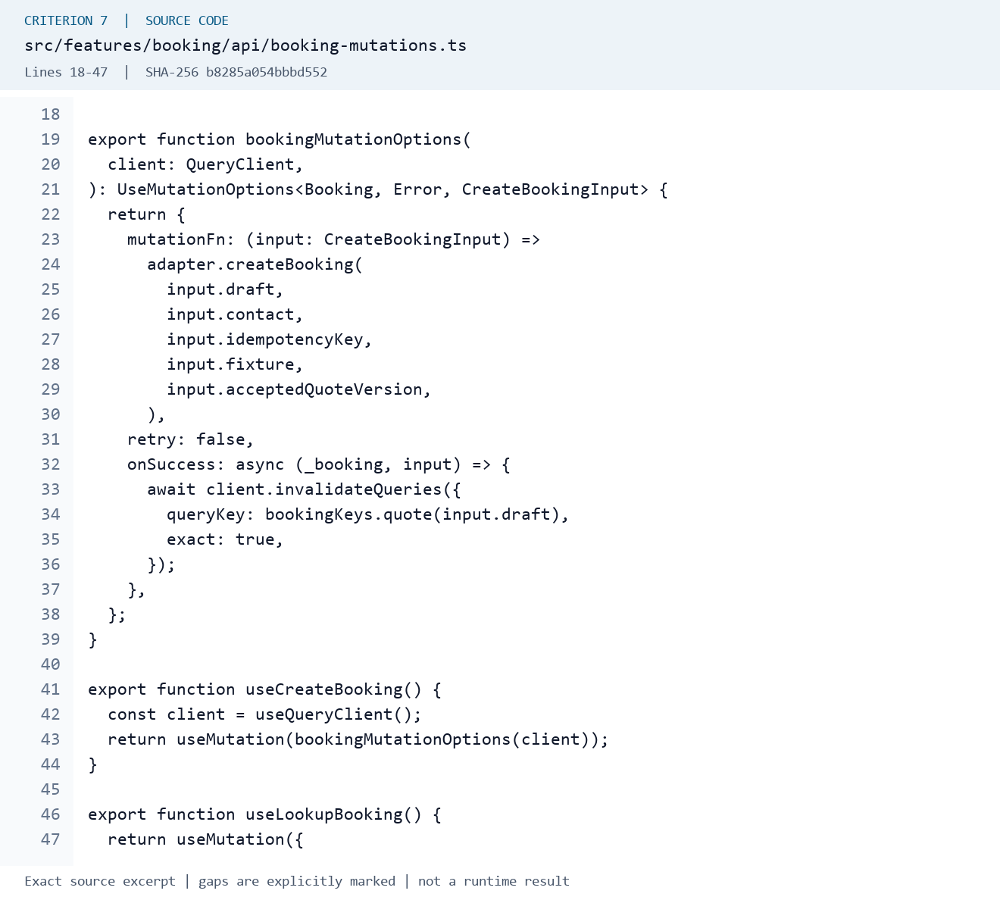

*Mutation thành công invalidates exact quote và không tự retry. Nguồn: `src/features/booking/api/booking-mutations.ts`, dòng 18–47.*

<!-- /SOURCE-IMAGES-7 -->

### Kết quả

Trace lịch sử [`query-cache-trace.json`](evidence/query-cache-trace.json) ghi `catalogCalls: 1`, `quoteCalls: 2`: hai tìm kiếm tương đương dùng lại catalog; quote active được gọi ban đầu và gọi lại sau mutation. Trace thể hiện chuỗi `invalidated: true` → `fetchStatus: fetching` → `success/idle`.

[`query-lifecycle.test.ts`](../tests/query-lifecycle.test.ts) dùng QueryClient thật: hai lần fetch fresh cùng kết quả 1; làm timestamp cũ rồi fetch được 2; query inactive được GC; query lỗi giữ trạng thái error và retry chủ động có thể phục hồi. Các test này đạt trong lần `npm test` gần nhất, dù toàn suite vẫn có một test file router lỗi do thiếu dependency.

### Ý nghĩa và vị trí của cơ chế

Keys ở lớp API quyết định cache có tái sử dụng đúng hay không; options đặt chính sách vòng đời; mutation đặt liên hệ giữa ghi dữ liệu và làm mới cache. `staleTime` không phải timer tự fetch mỗi N giây; stale không đồng nghĩa cache đã bị xóa. Query disabled có thể pending nhưng fetchStatus idle. Demo không trừ chỗ thật nên không được mô tả mutation này đã cập nhật tồn kho/departure.

**Tự kiểm:** structural query key, `keepPreviousData`, freshness/GC, observer và exact invalidation là bằng chứng TanStack Query. Hàm tính tiền hay HTTP request đơn lẻ không chứng minh các cơ chế đó.

## 8. Build production, dynamic import, Suspense và Error Boundary

### Khái niệm/cơ chế

`React.lazy` chuyển dynamic import thành component tải bất đồng bộ. Suspense render fallback trong lúc component suspend; Error Boundary xử lý lỗi render ở cây con. Vite build biến graph module và dynamic import thành asset/chunk, còn manifest mô tả quan hệ giữa chúng. Ba nhiệm vụ này có liên hệ nhưng không đồng nhất.

### Thực hành hoặc mã nguồn

`routes.tsx` khai báo bảy page bằng `lazy(() => import(...))` tại module scope. Root layout bao `Outlet` trong `Suspense` và `PageBoundary`. [`PageBoundary.tsx`](../src/shared/components/PageBoundary.tsx) là class component có `getDerivedStateFromError`, nhận fallback tùy chỉnh. Key boundary kết hợp pathname và số lần reset để tạo instance mới khi phục hồi.

[`UiTestPanel.tsx`](../src/shared/components/UiTestPanel.tsx) dùng `use(result)` với Promise chờ 1,8 giây để minh họa Suspense và dùng lỗi chủ động để minh họa boundary cục bộ/bao ngoài. Bảng này chỉ được mount trong DEV. [`vite.config.ts`](../vite.config.ts) bật `build.manifest`; [`analyze-build.mjs`](../scripts/analyze-build.mjs) đọc manifest và cộng dependency tĩnh duy nhất.


<!-- SOURCE-IMAGES-8 -->
### Ảnh trích source chính xác

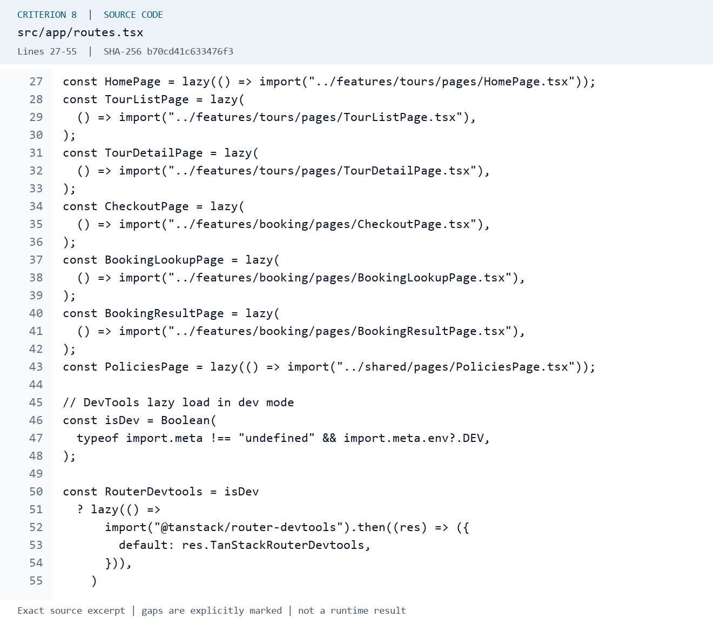

*Dynamic import qua React.lazy và nhánh devtools development. Nguồn: `src/app/routes.tsx`, dòng 27–55.*

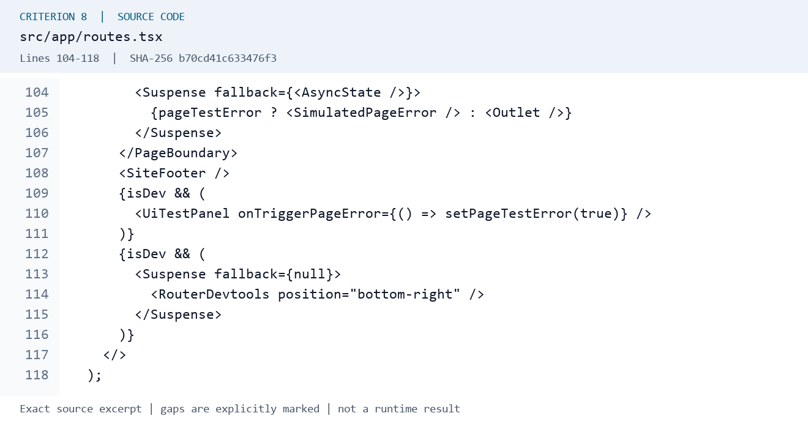

*Suspense bọc Outlet và các thành phần kiểm thử DEV. Nguồn: `src/app/routes.tsx`, dòng 104–118.*

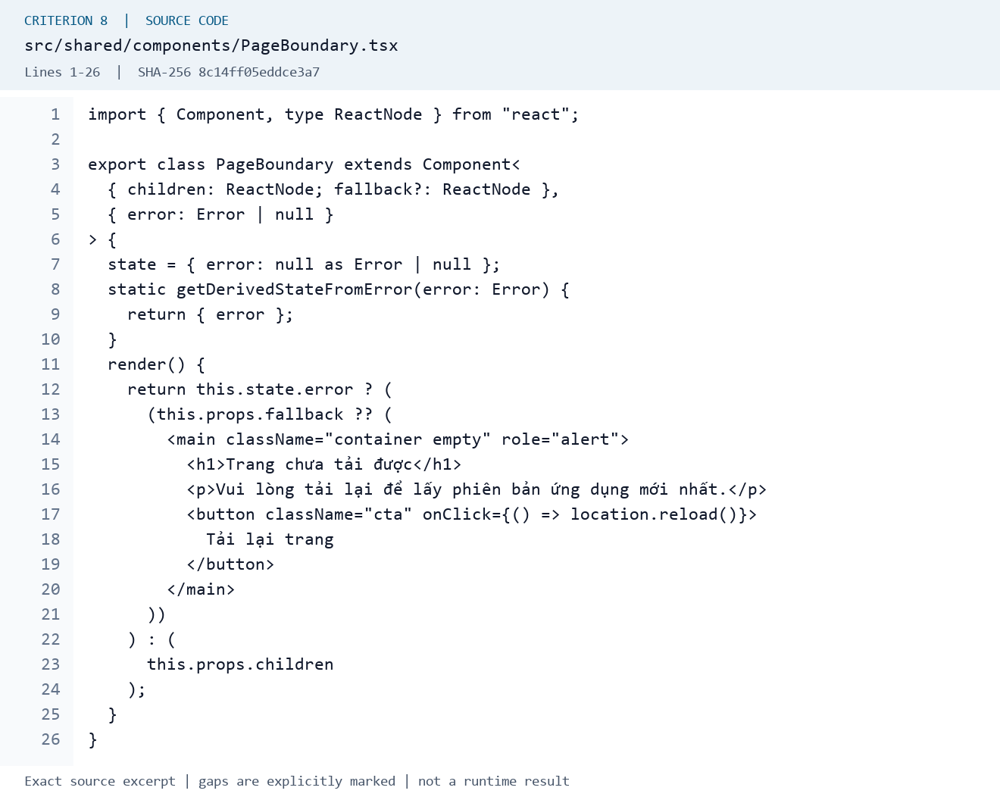

*getDerivedStateFromError và fallback của React Error Boundary. Nguồn: `src/shared/components/PageBoundary.tsx`, dòng 1–26.*

<!-- /SOURCE-IMAGES-8 -->

### Kết quả

Minh chứng build cũ [`bundle-report.json`](evidence/bundle-report.json) ghi 7 route chunk; JS entry + dependency trang chủ 283.780 byte, gzip cộng từng file 90.768 byte. Baseline trong cùng file là 314.260 và 98.040 byte, tương ứng giảm khoảng 9,70% thô và 7,42% gzip. Đây là so sánh lịch sử gồm cả refactor/cập nhật toolchain, không cô lập riêng lazy import.

[`production-chunk-requests.json`](evidence/production-chunk-requests.json) ghi trang chủ chưa tải CheckoutPage chunk, sau điều hướng checkout mới xuất hiện chunk đó. Các hash và dung lượng thuộc build trước merge, không phải build có Router/RHF hiện tại. E2E cho bảng kiểm thử UI có trong `e2e/booking.spec.ts`, nhưng chưa có bằng chứng chạy đạt sau merge. Source có fallback không có nghĩa mọi lỗi mạng đều đã được kiểm thử hoặc boundary bắt được mọi lỗi async/event handler.

### Ý nghĩa và vị trí của cơ chế

Dynamic import đặt ranh giới tải code ở lớp route; React cung cấp trạng thái chờ/lỗi của cây UI; Vite tạo tài nguyên để browser tải. `getDerivedStateFromError` giải thích vì sao lỗi render cây con đổi sang fallback, trong khi header/footer ngoài boundary vẫn tồn tại. Không suy ra “có Suspense” thì mọi `useQuery` thường tự suspend: query hooks hiện dùng `useQuery`, không phải `useSuspenseQuery`.

**Tự kiểm:** phải chỉ được dynamic import nào tạo page chunk, fallback nằm ở cây React nào và request chunk nào đã xuất hiện. Nhận xét “build nén file, website tải nhanh” không đủ chứng minh cơ chế trong đồ án.

## Đánh giá trước khi nộp

| Tiêu chí | Dấu vết riêng của công nghệ phải trình bày được | Giới hạn cần nói đúng |
|---|---|---|
| 1 | Component/Context/state, effect cleanup; RHF register và resolver | RHF chưa sở hữu submit checkout |
| 2 | Route tree, params/search validation, loader nối QueryClient | Không còn router useSyncExternalStore; chưa chứng minh preload mọi link |
| 3 | Strict typing, module augmentation, plugin React/Fast Refresh | Transform TS không thay typecheck; HMR evidence là bản cũ |
| 4 | Reconciliation key, memo/callback, React Profiler | Số 18 → 0 chưa đo lại sau khôi phục RHF |
| 5 | Thứ tự hook, dependency/closure, functional update, ref | Cấu hình lint chưa phải kết quả lint đạt |
| 6 | Context/provider lifetime và QueryClient cache lifetime | Server state qua adapter demo |
| 7 | Query key, freshness/GC, observer, exact invalidation | Không tự fetch theo chu kỳ staleTime; không có inventory thật |
| 8 | React lazy/Suspense/boundary, Vite manifest/chunk | Build metrics và request trace thuộc bản trước merge |

Khi bảo vệ, bắt đầu từ thao tác cụ thể (đổi filter, nhập tên, chọn gói, mở gallery, vào checkout), chỉ ra hàm/component sở hữu cơ chế, rồi đưa log/test/JSON tương ứng. Nếu kết quả mới chỉ suy ra từ source, gọi đó là đối chiếu mã nguồn; không nâng thành kết quả đo thực nghiệm. Báo cáo này không thay thế lần chạy xác minh source cuối cùng trước khi nộp.
